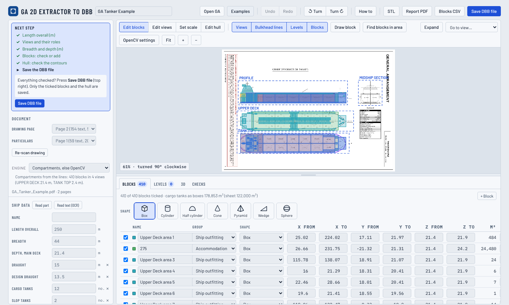

# GA 2D extractor to DBB

**From a ship's general arrangement drawing to a Ship Design Building Block project.**

GA 2D extractor to DBB reads a general arrangement (GA) drawing and turns it into a project for the Ship Design Building Block Editor (DBB). The drawing can be a vector PDF, a DXF or SVG file, or a picture (scan, JPG, PNG). The project holds blocks for the compartments, the decks, a hull and the main particulars. The app proposes; you check and correct; then you save.

It runs entirely in your web browser. The drawing is never uploaded, and the app works offline.

**Open the app:** https://shiplab.github.io/ga/



> **Educational use.** GA 2D extractor to DBB is a teaching and early-design tool. Everything it produces is an estimate read from a drawing, and it can be wrong. Do not use it for design approval, class or flag-state documents, stability or other safety-critical decisions.

## What it does

- **Reads vector PDFs from their geometry.** The lines and text of the PDF are read directly. Every closed compartment of every titled view (profile, deck plans, tank top) becomes a block, named from the text inside it.
- **Reads pictures with computer vision.** OpenCV finds the closed compartments of each view, and OCR (Tesseract) reads the titles and the names. Settings let you tune what counts as a line, and an overlay shows what OpenCV sees.
- **Finds the main particulars** (length, beam, depth, draught, double bottom, tanks …) on the particulars page.
- **Guesses the hull** from the deck plans, interpolating between the decks, with a round bilge under the lowest one. The contours can be edited.
- **Saves** a DBB project (JSON), an STL solid, a blocks CSV and a PDF report. The report has the GA drawn again from the blocks, the hull with its body plan and 3D views, and the blocks table.

## Quick start

1. Open https://shiplab.github.io/ga/ and press **Examples**, or **Open GA** with your own file.
2. Follow the **Next step** box on the left.
3. Check the views, the scale and the blocks. Fix them with Edit views, *Find blocks in this view*, Draw block and the table.
4. Press **Save DBB file** and open it in DBB.

The **[manual](docs/manual.pdf)** ([Markdown](docs/manual.md)) explains every step. It also explains the theory (pdf.js, OpenCV, OCR), the formulas and assumptions, and the limitations. A sample report is in [docs/sample-report-tanker-example.pdf](docs/sample-report-tanker-example.pdf).

## Example GAs

Three simplified general arrangements, made for teaching and free to use, are in [`examples/`](examples/):

- a platform supply vessel (92 m)
- a river cruise ship (150 m, eight deck plans)
- a crude/product tanker (115,000 dwt)

Each has an answer key with every compartment, and the app is scored against it:

| Example (vector PDF) | Compartments caught | One block per compartment | Particulars |
|---|---|---|---|
| PSV | 227 of 229 (99%) | 190 of 229 (83%) | 7 of 7 |
| River cruise | 503 of 503 (100%) | 449 of 503 (89%) | 7 of 7 |
| Tanker | 273 of 273 (100%) | 268 of 273 (98%) | 11 of 11 |

See [examples/README.md](examples/README.md) for how the keys and the scores are made.

## Why it works offline

Everything runs in the browser:

- The app is plain HTML and JavaScript.
- PDF reading uses pdf.js.
- OpenCV and Tesseract run as **WebAssembly**.
- pdf.js, the Tesseract engine and its English data are built into `index.html`; OpenCV is in `vendor/opencv.js`.

There is no server and no upload, and the same file with the same settings always gives the same result. To use it without internet, download the repository and open `index.html`. If the browser blocks local files, serve the folder with any static server:

```
python3 -m http.server
```

## Repository

| Path | What |
|---|---|
| `index.html` | The app: a single page with pdf.js, Tesseract and the fonts built in |
| `vendor/opencv.js` | OpenCV.js 5.0 (WebAssembly embedded), loaded when a drawing is analysed |
| `examples/` | The three example GAs, their answer keys (`keys/`) and scores |
| `docs/` | The manual (Markdown and PDF), its screenshots, a sample report |
| `src/` | Source: `app.js` (the page), `core.js` (geometry, particulars, hull), `rooms.js` (compartments from vector lines), `ocv.js` and `gacv.js` (OpenCV), `vision.js` (picture analysis), `ocr.js` (Tesseract), `decks.js` (passenger deck plans), `pdf.js` (report writer), `body.html`, `style.css` |
| `build.js` | Builds the page from `src/` |
| `dev/` | Scoring against the answer keys, tests and the manual tools |

## Build

Requires Node.js 18 or later.

```
npm install
npm run pages        # builds dist/, then copies the page to index.html and OpenCV to vendor/
```

`npm run build` builds into `dist/` only. To check the app against the example keys:

```
cd dist && python3 -m http.server 8765 &
node dev/examples-test.js
node dev/dump-app.js examples/GA_PSV_Example.pdf out/psv-app.json
python3 dev/gascore.py psv out/psv-app.json
```

The manual PDF is made with `node dev/manual-pdf.js` (it needs pandoc and Playwright).

## GitHub Pages

In the repository settings, go to Pages, choose **Deploy from a branch**, then the `main` branch and the `/ (root)` folder. The app is then served at https://shiplab.github.io/ga/. The `.nojekyll` file makes Pages serve the files as they are.

## Credits and citation

Developed by **Henrique Gaspar, NTNU**, 2026, to be merged into DBB.

Gaspar, H.M. (2026). *GA 2D extractor to DBB* [Computer software]. NTNU. https://github.com/shiplab/ga

This work was inspired by an early attempt published in:

- Legaz, M.J., Gaspar, H.M. (2024). Computer vision for reverse engineering in the design, simulation and operation of maritime systems. *Communications of the ECMS*, 38(1). https://doi.org/10.7148/2024-0234

An earlier use of OpenCV by the author:

- Fonseca, I.A., Gaspar, H.M. (2020). Fundamentals of digital twins applied to a plastic toy boat and a ship scale model. *Communications of the ECMS*, 34(1). https://doi.org/10.7148/2020-0207

Uses [pdf.js](https://github.com/mozilla/pdf.js), [OpenCV.js](https://opencv.org) and [Tesseract.js](https://github.com/naptha/tesseract.js), all Apache-2.0, and the fonts Barlow and IBM Plex Mono (SIL OFL).

## Disclaimer

GA 2D extractor to DBB is an educational and research tool. Its results are approximate and can be wrong. They are not a substitute for the original ship data or the judgement of a naval architect. The software is provided as it is, without warranty of any kind. The drawings you open stay on your computer and remain the property of their owners.
