# What GA 2D extractor to DBB does

**GA 2D extractor to DBB** reads a ship's **general arrangement (GA)**, the 2D drawing with the profile, the deck plans, the tank plan and often a midship section. It turns the drawing into a project for the **Ship Design Building Block Editor (DBB)**: blocks for the compartments, decks, a hull, and the main particulars.

The app proposes; you check and correct; then you save. It runs in your browser, on your computer: the drawing is not uploaded anywhere.

> **Educational use.** GA 2D extractor to DBB is a teaching and early-design tool. Everything it produces is an *estimate read from a drawing*, and it can be wrong. Do not use it for design approval, class or flag-state documents, or safety-critical decisions. Always check the results against the source.

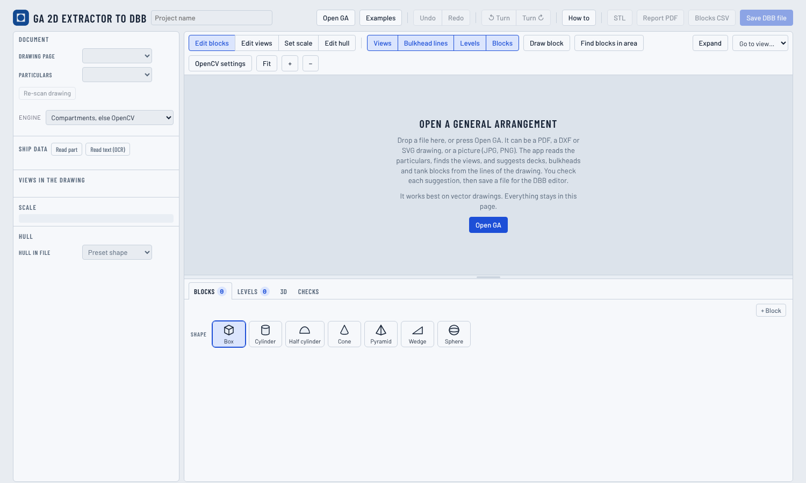

# Quick start

1. Press **Examples** and open one, or press **Open GA** with your own file (PDF, DXF, SVG, JPG, PNG or WebP).
2. Follow the **Next step** box at the top of the left panel.
3. Check the **ship data**, the **views** and their roles, and the blocks.
4. Fix what is wrong: **Edit views**, **Find blocks in this view**, **Draw block**, the blocks table, **Edit hull**.
5. Press **Save DBB file** and open it in DBB. **Report PDF**, **STL** and **Blocks CSV** are also available.

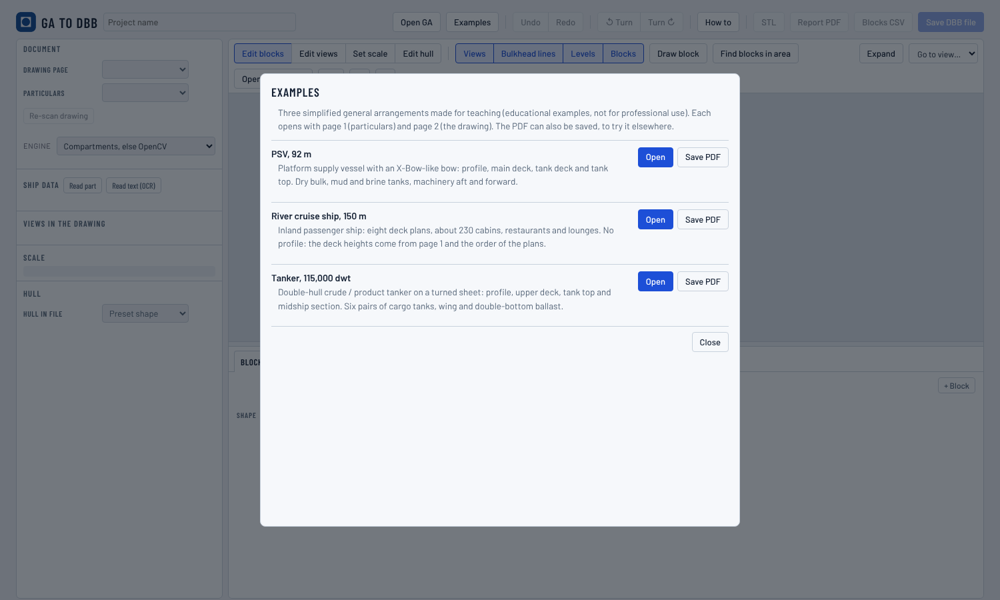

# The screen

- **Top bar:** Open GA, Examples, Undo and Redo, Turn (quarter turns), How to (with About), and the save buttons: STL, Report PDF, Blocks CSV, Save DBB file.
- **Left panel:** *Next step*; *Document* (drawing page, particulars page, **Re-scan drawing**, the **Engine** and a note on how the drawing was read); *Ship data*.
- **Centre:** the drawing, turned upright, bow to the right. Modes: **Edit blocks**, **Edit views**, **Set scale**, **Edit hull**. Overlays (Views, Bulkhead lines, Levels, Blocks) only change what is shown. **Go to view** zooms to one view (keys 1 to 9). **OpenCV settings** opens the settings of the image analysis.
- **Bottom:** the tabs Blocks, Levels, Hull, 3D and Checks. Drag the grey bars to resize; **Expand** gives the drawing the whole window.

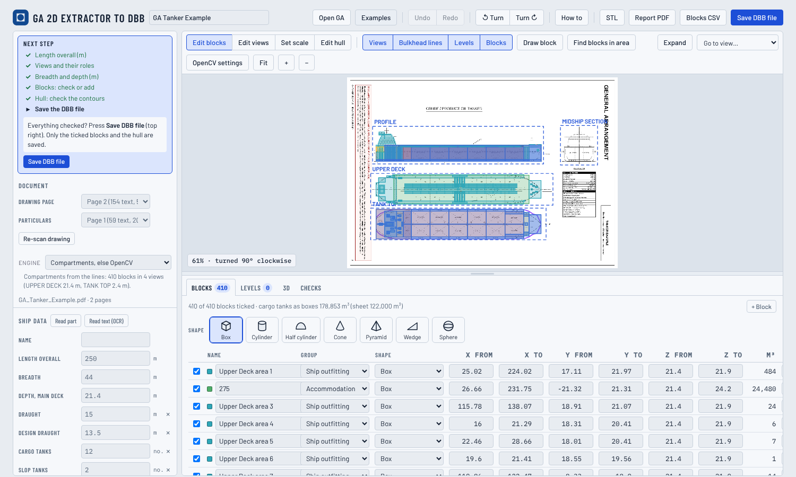

# What to open

| Kind of file | How it is read | What to expect |
|---|---|---|
| **Vector PDF** (a drawing made by a CAD program) | The lines and the text of the PDF | The best results. Every closed compartment of every titled view becomes a block, named from the text inside it. |
| **DXF or SVG** | The lines of the file | As a vector PDF, without the particulars page. |
| **Picture** (scan, photo, JPG, PNG, or a PDF page that is one image) | OpenCV finds the compartments in the image; OCR reads the text | Good on clean sheets; more checking needed on low-resolution or crowded scans. |

**Vector or picture is decided automatically** when the file opens, and a message says which. A PDF page counts as a picture when its content is mostly one large image, with few lines and little text. A scan with an invisible OCR text layer also counts as a picture.

**Which page.** With several pages, the app takes the page with the most drawing as the GA. It takes the page with the most text as the particulars. Change them in *Document* if needed.

**If the length is not known**, the app assumes 100 m and says so. Type the real length overall and everything scales with it.

# Step by step

## 1. Ship data

Values are read from the particulars page: length overall, beam, depth, draught, double bottom, number of tanks, volumes and more. Fields in italics are estimates. **Read part** reads a table with OCR: drag a rectangle around it. Values that DBB does not use (builder, IMO number and so on) are kept as notes in the saved file.

## 2. Views and roles

The drawing is split into **views**. Each view has a role: *profile*, *deck plan*, *tank plan*, *plan*, *section*, or *ignore*. In **Edit views**, click a view to select it and set its role in the bar. Drag a view to move it, and drag its edges to resize it. **+ View** adds a view and **Delete view** removes one. The × closes the tip bar; it opens again when another view is selected.

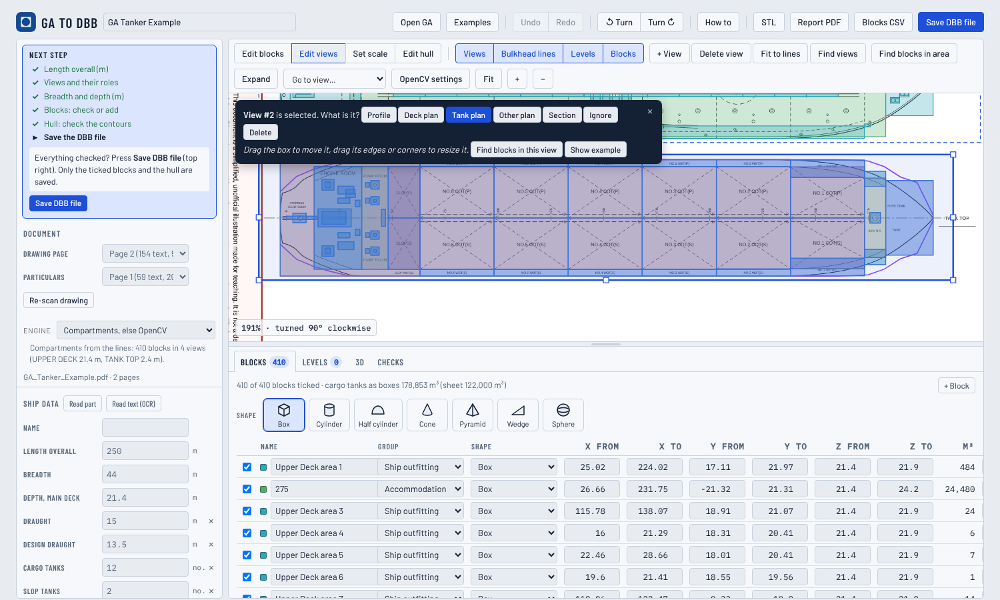

## 3. Scale

- **Vector drawings:** from the scale bar (numbers 0, 10, 20 … with "m") when there is one. Otherwise from the length overall over the length of the longest plan.
- **Pictures:** from five points found on the hull: stern and bow at the keel, the main deck, the centreline and the side. Then it is checked against the compartments found. If it is wrong, press **Set scale** and click the five points.

## 4. Blocks

A block is a box (or another shape) with x, y and z limits, a name and a group. Edit them in the table, or on the drawing: click to select, drag to move, drag the edges to resize, **Draw block** to add one, **Delete** to remove one. The shape buttons above the table set the shape of the selected block.

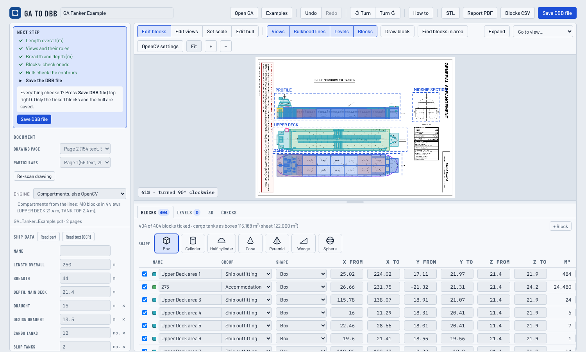

### Find blocks in this view

When compartments are missing, open **Edit views**, select the view and press **Find blocks in this view**. OpenCV reads that view again and proposes, in orange, the compartments that are not blocks yet. **Add them** accepts the proposal; **Cancel** discards it.

- On a **plan**, blocks get length and breadth; their height runs from the deck of that plan up to the next plan above.
- On the **profile**, blocks get length and height; their width is assumed to be half the beam, centred.
- On a **section**, the button is *Read heights from this section*. It lists the heights of the decks and flats above the bottom. It offers to set the double bottom from the first height between 0.6 and 3.5 m.

Blocks you draw or find are kept when the drawing is read again (Re-scan, a new role, a new length).

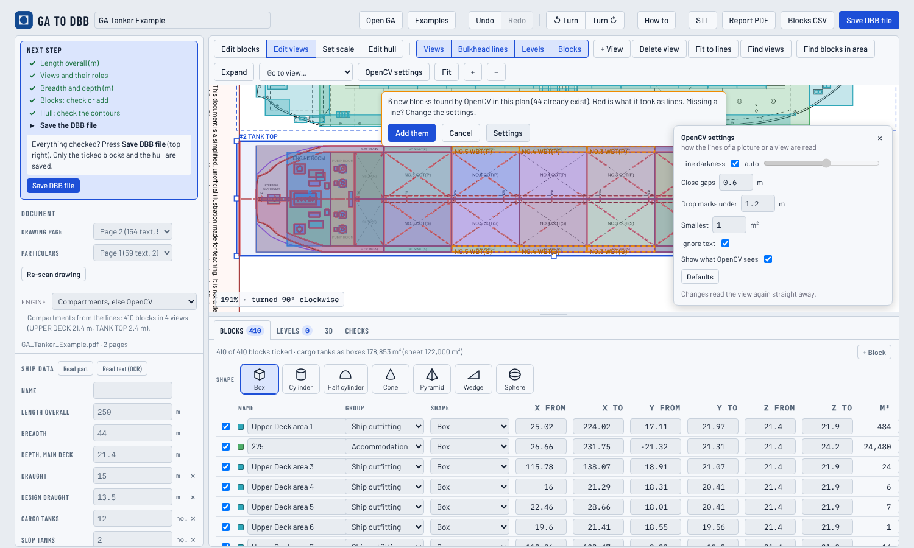

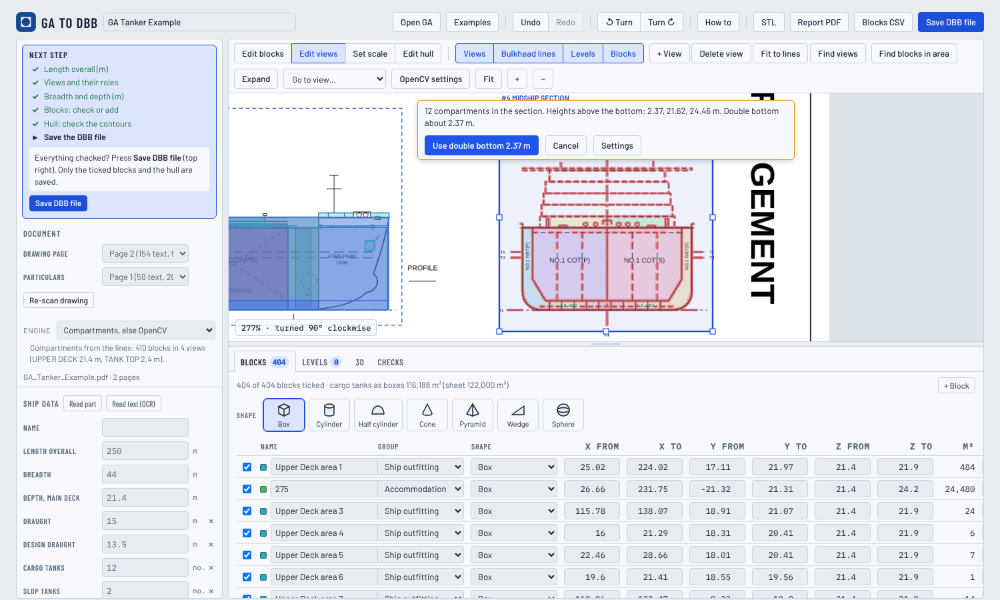

### OpenCV settings

The **OpenCV settings** button, next to Fit, opens five settings and a switch:

| Setting | Default | What it does | Change it when |
|---|---|---|---|
| Line darkness | auto | What counts as a line: chosen by the picture (Otsu method) or set by hand (0 to 255) | Grey lines are lost (raise it), or grey fills become walls (lower it) |
| Close gaps | 0.6 m | Gaps in lines up to this width are closed (doors, dashed lines) | Rooms leak into each other (raise it); narrow cofferdams disappear (lower it) |
| Drop marks under | 1.2 m | Pieces of ink smaller than this every way are dropped as text or marks | A short bulkhead is lost (lower it); text makes small false rooms (raise it) |
| Smallest | 1 m² | Compartments smaller than this are not proposed | Too many tiny blocks (raise it) |
| Ignore text | on | The text read by OCR is blanked before the lines are searched | A word box cuts a line (turn it off) |
| Show what OpenCV sees | on | Red overlay of the lines it used, colours for the compartments | (a view only) |

While *Find blocks in this view* is open, every change reads the view again at once. On a picture GA, with nothing open, a change reads the whole picture again. The settings are remembered in your browser.

## 5. Hull

The hull is guessed when the drawing is read (see *How it works*). **Edit hull** shows the three contours: the plan, the keel and sheer, and the section. Drag a point to move it, double-click to add one, and right-click to remove one. The **3D** tab shows the hull with the blocks.

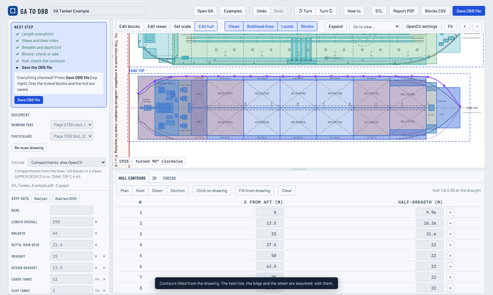

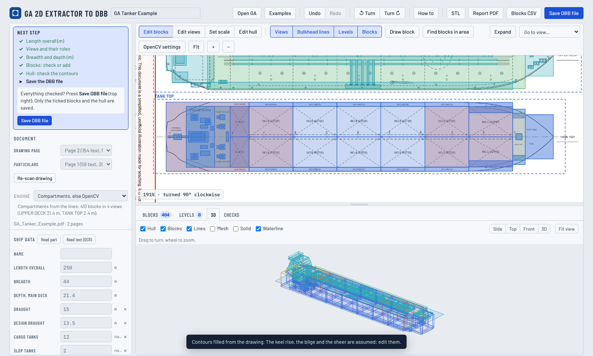

## 6. Checks

The **Checks** tab compares what was found with the particulars, for example the cargo volume on the sheet against the volume of the cargo blocks. It warns when a value is missing or looks wrong.

## 7. Save

- **Save DBB file:** the DBB project (JSON) with the ticked blocks, decks, hull and notes.
- **STL:** the ticked blocks and the hull as one solid, in metres.
- **Blocks CSV:** the blocks as a table.
- **Report PDF** (A4 landscape), in this order:
  1. the ship data and the original drawing with the blocks over it;
  2. the general arrangement drawn again from the blocks: the profile, then one plan per deck with the hull outline at that height;
  3. the hull: its dimensions, an estimated block coefficient and displacement, the body plan, and two 3D views;
  4. how the drawing was read: the engine, the views, the deck heights, the notes, the settings and the assumptions;
  5. the blocks table with the totals by group.

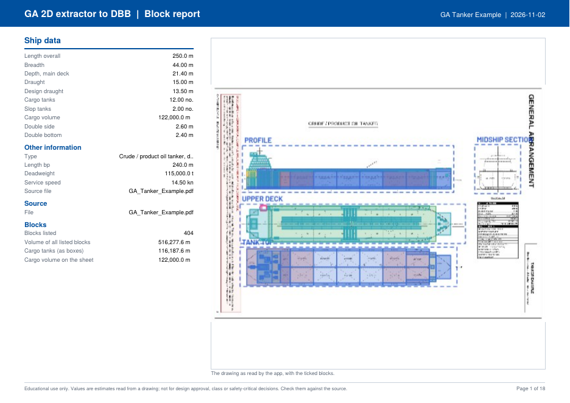

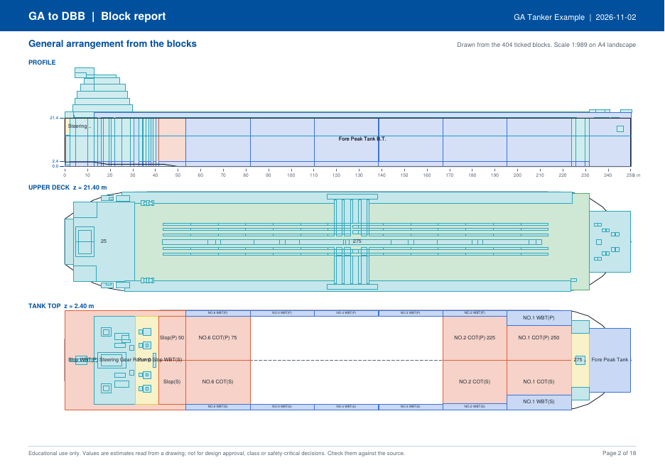

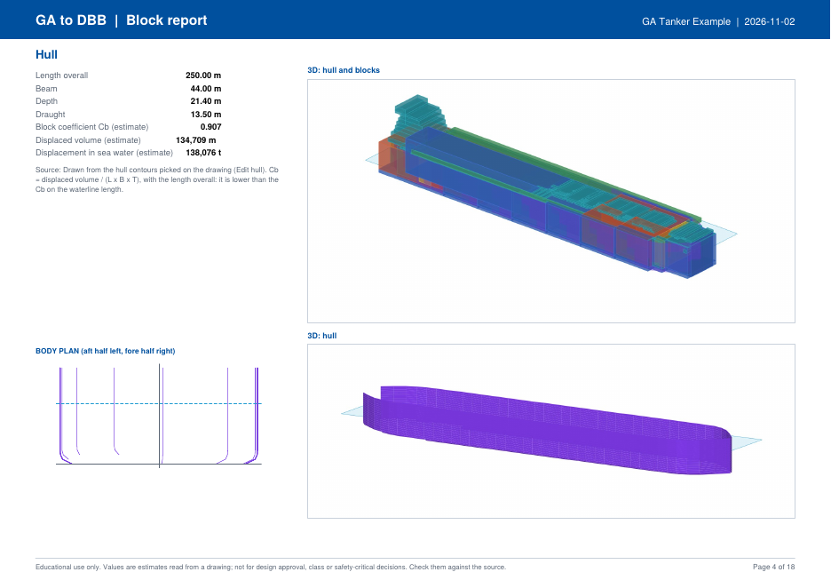

## 8. Pictures and scans

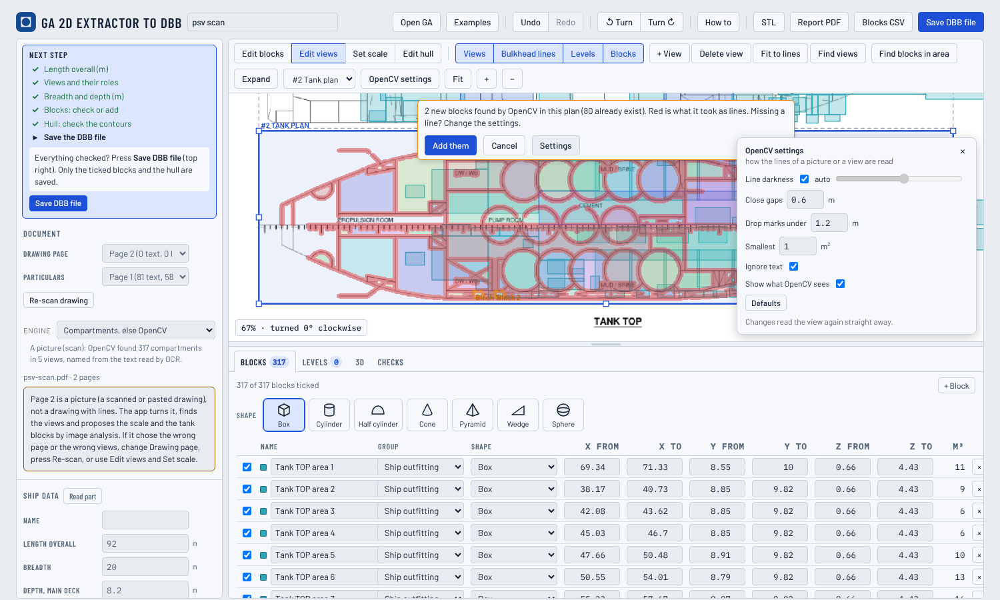

With a picture, check in this order:

1. The sheet is **upright**, bow to the right. Press **Turn** if not.
2. The **views** and their roles.
3. The **scale**: the length overall is right and the blocks sit on the drawing.
4. The **blocks**: use Find blocks in this view, the OpenCV settings, Draw block and the table.

# The theory behind it

GA 2D extractor to DBB does not "understand" a drawing the way a naval architect does. It combines four well-known techniques, each doing one simple thing well, and joins their results with rules from ship design. It uses no generative AI and no language model, and nothing is learned from your drawings.

## Vector drawings: geometry, not pixels

A PDF made by a CAD program stores the drawing as **geometry**: line segments, curves and text placed at exact coordinates. **pdf.js**, the PDF reader built into Firefox, gives the app the list of drawing operators of a page. From it the app takes every line, with its width and its dash pattern, and every piece of text, with its position, size and direction. Because nothing has to be recognised, these drawings give the best results: a bulkhead is a line, and a label is text.

## Pictures: computer vision with OpenCV

A scan or a photo is only a grid of pixels. **OpenCV** (Open Source Computer Vision Library) is a widely used library of image-processing methods. The app uses a few classical ones, in this order:

- **Thresholding** separates ink from paper. Otsu's method looks at the histogram of grey levels and picks the threshold that best splits it into two classes, dark and light. It does this by maximising the variance between the two classes.
- **Morphology** changes shapes with a small *structuring element*, here a disc. *Dilation* grows the ink by the radius of the disc, so that the dashes of a broken line and the gap of a door opening join into a closed wall.
- **Connected components** label every group of touching pixels. On the ink, it finds the small pieces (text, symbols, hatching) that can be dropped. On the paper, it finds the closed white regions, and these are the compartments.
- **Bounding boxes and areas** of the regions give the size and place of each compartment in pixels. The scale turns pixels into metres.

These steps have **parameters** (the threshold, the gap, the mark size, the smallest area). This is why the app has *OpenCV settings*: a drawing with thin grey lines needs other values than a bold black one. Many more steps (finding the views, the turn and the hull outline on a picture) are made of the same building blocks: thresholds, projections of ink along rows and columns, and connected regions.

## Text in pictures: OCR with Tesseract

**OCR** (optical character recognition) turns the image of text into characters. The app uses **Tesseract**, an open-source OCR engine. Tesseract finds lines of text in the image, and a recurrent neural network (LSTM) trained by its authors on printed text reads each line into characters. Each word comes with a box and a confidence. The app uses OCR:

- to check the reading direction, which decides whether the sheet must be turned by 180°;
- to find the view titles (PROFILE, TANK TOP …), which give the roles and the deck heights;
- to name the compartments from the words inside them, and to read the particulars (*Read part*).

OCR can misread small, rotated or handwritten text, and words with confidence under 45% are ignored. The trained network is fixed: it does not learn from your drawings.

## Ship-design rules join the pieces

What turns compartments into a ship is a set of plain rules, all listed in *How it works* below:

- A plan is a horizontal cut at a deck, and its blocks reach up to the next deck.
- The profile gives heights, and the hull is symmetric about the centreline.
- A tank top sits on the double bottom.
- The beam and the length overall fix the scale.

These rules are why the results can be checked: each number can be traced to a line, a word or a stated assumption.

## Why it works offline

Everything runs **inside your web browser, on your own computer**:

- The app is plain HTML and JavaScript.
- pdf.js is JavaScript.
- OpenCV and Tesseract are written in C++ and compiled to **WebAssembly**, a portable binary format that browsers run at close to native speed.
- The OpenCV library, the Tesseract engine and its English language data are **included with the app** (in the page and in `vendor/`), so nothing is downloaded while you work.

As a result:

- **No upload:** the drawing is read from your disk into the browser's memory and never leaves your computer. There is no server that receives files.
- **No internet needed:** once the app has loaded, or when you open the offline copy, it works without a connection.
- **The same result every time:** the same file and the same settings give the same blocks, because no remote service or model is involved.

The price is speed and memory. OCR of a full sheet takes about a minute, and a large scan can use a few hundred megabytes of memory in the browser.

# How it works

This section describes the logic, the formulas and the assumptions. Coordinates are in metres: **x** forward from the aft end, **y** to port (negative to starboard), **z** up from the baseline.

## Turning the sheet

- **Vector PDF:** the reading direction of the view titles (PROFILE, DECK, PLAN, SECTION, TANK TOP …). Each title is weighted by its letter size squared, and the sheet is turned when 75% of that weight reads one way. Otherwise the direction of the lines decides.
- **Picture:** the layout decides first (the profile on top, the plans below, the bow to the right). Then the OCR reads the text both ways up and turns the sheet by 180° if the text reads clearly better that way.

## Finding the views and their titles

The lines of the drawing are drawn thick, so that the lines of one view join, and each joined group is a view. Tables, where text covers more than 8% of the area, are dropped. A **title** is upper-case text, at least 1.25 times the usual capital height, that names a view (…DECK, PROFILE, ELEVATION, SECTION, PLAN, TANK TOP, DOUBLE BOTTOM …). Titles and views are paired globally, closest pairs first. A title under a view counts at its distance; a title above counts at twice its distance plus a penalty, so that it is not given to the next view. The role follows the title: PROFILE or ELEVATION gives the profile, SECTION a section, anything else a plan. A deck name written *inside* the profile does not make the profile a plan.

## Compartments

- **Vector PDF:** the solid lines of each titled view are drawn again at a fixed resolution. Gaps up to 0.6 m are closed, and every closed white area that does not touch the view border is a compartment. An area holding two or more labels is cut again with 1.6 m gaps closed, to split rooms joined by a door.
- **Picture (OpenCV):** each view is cropped and turned to grey, then processed in six steps:
  1. **Ink:** the pixels darker than the threshold (Otsu, or the darkness setting).
  2. **Text removed:** the boxes of the words read by OCR are blanked.
  3. **Gaps closed:** the ink is grown by a disc of radius r = gap / 2 × (pixels per metre), so dashes and door openings join into walls.
  4. **Marks dropped:** ink pieces smaller than markM × (pixels per metre) + 2r in both directions are removed.
  5. **Rooms found:** the remaining white is split into 4-connected regions. A region touching the view border is outside the hull and is dropped.
  6. **Size check:** a region is kept when its area, grown back by the wall, A + 2r(w + h), is at least the smallest area setting. Its box is widened by r on each side.

**Names and groups.** The text inside a compartment becomes its name, and keywords set the group:

| Keywords | Group |
|---|---|
| COT, CARGO TANK/HOLD, SLOP | Cargo spaces |
| WBT, BALLAST, FW, FUEL, MUD, BRINE, VOID, PEAK, DB … | Tanks and voids |
| ENGINE, PUMP, SWITCH, PROPULSION, THRUSTER, STEERING … | Machinery |
| CABIN numbers, LOUNGE, RESTAURANT, MESS, BRIDGE, CREW … | Accommodation |
| anything else | Ship outfitting |

Compartments without text are named after their view ("Tank Top area 12").

## Scale and frame of each view

- **Scale (pixels or points per metre, ppm):** from a scale bar when one is read; otherwise ppm = (length of the longest plan's compartments) / LOA. With a picture, this replaces the five-point scale when the two agree within 25%. The breadth scale ppmA = (breadth of the plan's compartments) / B is used when it agrees with ppm within 8%.
- **Aft end:** the aftmost compartment of all views.
- **Centreline of a plan:** the dashed centreline when found (vector), otherwise the middle of the plan's compartments (the hull is symmetric).
- **Baseline of the profile:** the bottom of its compartments, or the baseline found in the drawing.
- Then, for a plan, x = (px − aft) / ppm and y = (centreline − py) / ppmA. For the profile, z = (base − py) / ppmZ.

Each view keeps its own frame, and *Draw block* and *Find blocks in this view* use the same frame, so new blocks line up with those found automatically.

## Deck heights

1. TANK TOP, INNER BOTTOM or DOUBLE BOTTOM sits on the double bottom height: from the particulars, else 8% of the depth.
2. UPPER, MAIN, WEATHER, FREEBOARD or STRENGTH DECK sits at the depth D, else 0.1 × LOA.
3. Other plans are spaced evenly between these two, in their order on the sheet (higher on the sheet = higher deck).
4. **Passenger ships** (four or more plans and no profile): the lowest plan sits on the double bottom (else 1.2 m), and each plan above adds one deck height (3.0 m unless given). The deck nearest the depth is set to the depth.

## Block heights and widths

- A plan block reaches from its deck **up to the next plan above**. On the highest plan it is **2.8 m** high when named and **0.5 m** when unnamed (open deck).
- A profile compartment that a plan block already describes is dropped (intersection over union ≥ 0.5 in x–z). The others get a width of **B/2, centred** (marked *width assumed*).
- A **double bottom** block is added under each compartment of the lowest plan when that plan stands 1 m or more above the baseline.

## The hull from the deck plans and the profile

The plans give the breadth of the hull; the profile gives its ends and its bottom.

1. **Deck outlines.** For each plan height k, the half-breadth b_k(x) at 41 stations is the largest |y| of the blocks of that plan covering x. A station between two blocks takes the mean of its neighbours.
2. **Beam check.** The outlines are scaled so that the widest point of the highest plan below the depth equals B/2. This is done only when the factor is between 0.7 and 1.4; otherwise the guess is not used.
3. **Waterplane shape.** The highest outline is made to fall monotonically forward and aft of the parallel body (the stations within 97% of the maximum). It is then smoothed with weights (1, 2, 1)/4, and the stem ends at 2% of B.
4. **Profile outline.** All closed compartments of the profile view below the depth are joined. For each height z (every 0.25 m), they give the aft end x_a(z) and the forward end x_f(z) of the hull.
   - Deck lines cut through the compartments, so the ends at each height are the outermost found within ±0.5 m of it.
   - The outline is grown by 0.3 m, because the compartments stop at the inside of the hull line.
   - The profile is stretched so that its ends are at 0 and at the length overall, which also corrects views of a scan that are not lined up.
   - The profile is used only if, in the upper half of the depth, it covers at least 85% of the length.
5. **Keel line.** Along the length, the keel z_k(x) is the lowest compartment within ±3 m. It is flat (z = 0) between the first and the last place where it is below 0.15 D, and it only rises towards the ends (rise of floor aft, forefoot).
6. **Fitting the waterlines to the profile.** At each height z, the deck outline is fitted between x_a(z) and x_f(z): a station x takes the breadth of the deck outline at x' = x_0 + (x − x_a)(x_1 − x_0)/(x_f − x_a), where [x_0, x_1] is the length of the deck outline. Outside [x_a, x_f] there is no hull. A raked or X-bow stem and a stern overhang are kept this way.
7. **Between decks**, linear interpolation: y(x, z) = b_k + (z − z_k)/(z_(k+1) − z_k) × (b_(k+1) − b_k).
8. **Under the lowest deck**, a round bilge of radius r = min(0.06 B, 0.9 b) on the half-breadth b of that deck. With h = z − z_k(x): y(h) = (b − r) + sqrt(r² − (r − h)²) for h < r, and y = b above.
9. **Without a usable profile**, the hull runs the full length at every height, and the keel rises aft as an assumed curve: z_k(x) = 0.12 T ((0.2 L − x)/(0.2 L))² for x < 0.2 L.
10. **With one plan only**, the same round bilge is used. If a midship section was read, its shape s(z) instead gives y = b(x) s(z)^p(x), with p fitted to the lower deck where there is one.

The hull stops at the depth D. Bow shapes above the main deck (an X-bow, a forecastle) are not part of it. Hull contours edited in **Edit hull** replace the guess.

The block coefficient and the displacement in the report are estimates from the offsets (trapezoidal rule):

- ∇ = Σ 2 ȳ Δx Δz below the draught T
- C_B = ∇ / (L B T), with L the length overall. It is therefore lower than C_B on the waterline length.
- Δ = 1.025 ∇ (sea water, t)

## Volumes

The volume of a block is the volume of its shape: box Δx Δy Δz, and smaller factors for a cylinder, cone, wedge and so on. It is **not** the volume of the real tank, which has rounded corners, a sloping bottom, frames and a hull side.

## The engines (Document panel)

| Engine | Use |
|---|---|
| Compartments, else OpenCV (default) | Vector PDF: compartments from the lines. Picture: compartments with OpenCV. If the compartments fail on a vector PDF, the OpenCV tank analysis runs instead. |
| OpenCV, else lines | The OpenCV tank analysis (regular bulkheads between the cargo tanks), useful on tankers and bulk carriers. |
| Lines only | The older reading of bulkhead lines and the particulars. |

# Accuracy

The three example GAs have answer keys: every enclosed compartment of each view, with its label, deck height and the particulars of page 1. A compartment is *caught* when blocks cover at least 60% of its box at the right place. A compartment has *one block* when a single block overlaps its box with an intersection over union of 0.5 or more.

| Example (vector PDF) | Compartments caught | One block per compartment | Particulars |
|---|---|---|---|
| PSV | 227 of 229 (99%) | 190 of 229 (83%) | 7 of 7 |
| River cruise | 503 of 503 (100%) | 449 of 503 (89%) | 7 of 7 |
| Tanker | 273 of 273 (100%) | 268 of 273 (98%) | 11 of 11 |

For pictures, the same sheets rendered as 150 dpi images give 317 blocks for the PSV and 644 for the river cruise ship (from its 7 deck plans). The tanker sheet is printed bow-up and needs one press of Turn. These picture runs are not scored against the keys yet.

# Assumptions and limitations

- **Heights are assumed** where the drawing does not give them: deck heights between the known ones, 2.8 m for named spaces on the highest plan, B/2 for profile-only blocks, 3.0 m per deck on passenger ships.
- **Boxes only:** compartments are proposed as boxes around their outline. Curved, stepped or sloping compartments (at the bilge, in the bow and stern) are larger than the real space.
- **One drawing page:** views spread over several pages (for example a profile on page 1 and deck plans on pages 2 and 3) are not combined yet. A page with a lines plan (sheer, half-breadth and body plan) can be taken as the GA by mistake: choose the right page in *Document*.
- **Pictures:** low resolution (under about 150 dpi), faint or grey lines, hatching and handwriting reduce the results. A picture sheet printed bow-up may stay at the wrong turn: press Turn. OCR takes about a minute and can misread names and numbers.
- **The hull** is a guess from the block outlines of the plans and the profile, at 41 stations and 22 waterlines. Its ends are only as good as the compartments of the profile: an end with no closed compartment is cut short. With one plan only, the bilge is assumed. Check it in Edit hull.
- **Particulars** are read by pattern matching of labels and values. Unusual labels (for example with words in brackets) can be missed: type them.
- **Copyright:** the drawings you open stay on your computer and remain the property of their owners.

# If something goes wrong

| What you see | What to do |
|---|---|
| The wrong page was used | Change *Drawing page* in Document, then **Re-scan drawing**. |
| The sheet is upside down or sideways | Press **Turn** until it is upright, bow to the right. |
| Views are wrong, merged or missing | **Edit views**: move, resize, add or delete boxes, and set their roles. |
| A view has no blocks | Edit views, select it, set its role, then **Find blocks in this view**. |
| Obvious lines are not seen | Open **OpenCV settings** and look at the red overlay: lower *Drop marks under*, change *Line darkness*, or turn off *Ignore text*. |
| Rooms leak into each other | Raise *Close gaps*. |
| The scale is wrong | Type the real length overall; on a picture use **Set scale**. |
| The hull looks wrong | **Edit hull**, or check that the deck plans have their blocks. |

# Shortcuts

| Key | Action |
|---|---|
| Ctrl+Z, Ctrl+Shift+Z (or Ctrl+Y) | Undo, redo |
| Wheel / drag | Zoom around the pointer / pan |
| 1 to 9 | Zoom to view 1 to 9 |
| F | Fit the drawing |
| Delete (Backspace on a Mac) | Delete the selected block, hull point or view |
| Esc | Cancel the tool; close a dialog |

# Educational use and disclaimer

GA 2D extractor to DBB is an **educational and research tool**, made for teaching ship design at NTNU and for early-stage concept work. Its results are approximate and can be wrong. They are not a substitute for the original ship data, class or flag-state documents, or the judgement of a naval architect. They **must not** be used for design approval, certification, stability or other safety-critical decisions. The software is provided as it is, without warranty of any kind; NTNU and the author accept no liability for its use.

# Credits

Developed by Henrique Gaspar, NTNU, 2026, to be merged into DBB. Citing: Gaspar, H.M. (2026). *GA 2D extractor to DBB* [Computer software]. NTNU.

## Earlier work

This work was inspired by an early attempt published in:

- Legaz, M.J., Gaspar, H.M. (2024). Computer vision for reverse engineering in the design, simulation and operation of maritime systems. *Communications of the ECMS*, 38(1). https://doi.org/10.7148/2024-0234

An earlier use of OpenCV by the author, for cameras as sensors in a digital twin:

- Fonseca, I.A., Gaspar, H.M. (2020). Fundamentals of digital twins applied to a plastic toy boat and a ship scale model. *Communications of the ECMS*, 34(1). https://doi.org/10.7148/2020-0207

Uses pdf.js (Apache-2.0), OpenCV.js (Apache-2.0) and Tesseract.js (Apache-2.0), and the fonts Barlow and IBM Plex Mono (SIL OFL).
